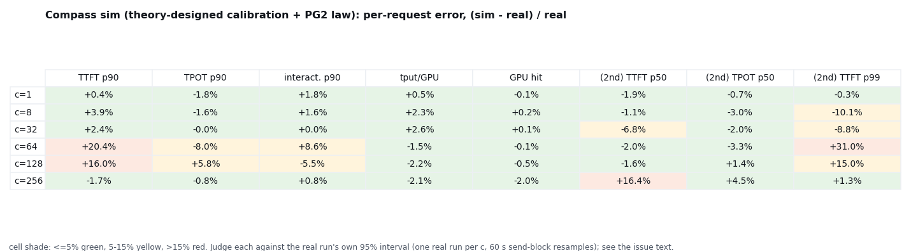

# Compass 仿真与实测对比

Compass 是 ATOM 推理引擎的虚拟时钟仿真器。这里放各 Cell 实测与仿真的 Prometheus 对比图，任务跟踪见 [#592](https://github.com/wuhuikx/LLM-Booster/issues/592)。

## 多配置看板（按模型 / 部署方式 / 并行配置 / 并发切换）

**交互式对比图：<https://wuhuikx.github.io/LLM-Booster/compass/dashboard.html>**

直接打开即可，不需要登录。

- **页面结构：** 顶部依次选模型、部署方式（PD 分离 / aggregated）、并行配置、并发。最上面的总览给出所有配置 × 并发的误差热力图，选一个指标（逐请求的 TTFT / TPOT / 吞吐，或任一 Prometheus 面板）和一个仿真 law 即可横向比较；下面是选中配置的误差矩阵、逐请求表和面板曲线（实线实测，虚线仿真）。误差 = 仿真 / 实测 − 1。
- **当前数据：** DeepSeek-V4.1-Flash 1P1D（P TP2 EP2，D TP4），Mooncake Store 开，pit2-p03-g27，c = 1 / 8 / 32 / 64 / 128，每档 1800 s agentic 实跑；仿真为每档自身记录拟合的定律（in-sample），sim_canon 为标准发送顺序，sim_1..3 为不同发送顺序种子，c=128 另有未清洗 KV 链路的 rawlink_canon。

  | 指标（sim_canon） | c=1 | c=8 | c=32 | c=64 | c=128 |
  |---|--:|--:|--:|--:|--:|
  | TTFT P50 | −7.0% | −1.7% | −2.8% | −3.7% | −6.2% |
  | TPOT P50 | 0.0% | −0.5% | −0.7% | −1.0% | −1.1% |
  | 吞吐/卡 | +0.6% | +0.1% | +0.6% | 0.0% | +0.5% |

  PD 部署的仿真报告不含 mesh 入口的 Overall TTFT 面板，所以总览里该面板指标为空；端到端 TTFT 请看逐请求的 TTFT 指标。
- **生成方式：** jgong5/ATOM `scripts/compass/compare_dashboard.py` 的多配置版本，见 [jgong5/ATOM#3939](https://github.com/jgong5/ATOM/pull/3939)（尚未合入；合入前请用该 PR 的分支 `compass/dashboard-multi-config` 生成，`dsv41/dev` 上的旧版不支持 `--scan` 和多配置）。新结果按目录约定放好即可自动出现在页面上，不用手写清单：

  ```
  ROOT/<模型>/<pd|aggregated>/<并行配置>/c<并发>/
      real/  prom/report-data.json  sims/<label>/prometheus.json  [one_real.txt]  [cell.json]
  ```

  `python3 scripts/compass/compare_dashboard.py --scan ROOT --out dashboard.html`，再把生成的页面替换本目录下的 `dashboard.html`。

## Cell A：单机 DPA4-EP4

**交互式对比图：<https://wuhuikx.github.io/LLM-Booster/compass/cellA_dashboard.html>**

直接打开即可，不需要登录。

- **对象：** DeepSeek-V4.1-Flash，MI355X 单机 4 卡，DPA4-EP4（4 个 DP attention rank + 专家并行），MTP 投机解码（5 个 draft，强制接受长度 3.51），bf16 KV，decode CUDA graph 档位 1–64，max-num-seqs 64。
- **实测：** 每个并发（c = 1 / 8 / 32 / 64 / 128 / 256）一次预热后的 30 min agentic 多轮真跑。
- **仿真：** Compass 用同一负载、同一请求序列。实线是实测，虚线是仿真，横轴是从第一个正式请求开始的分钟数，取 1800 s 计分窗口。
- **定律，即当前最优方案：理论构造的校准负载 + PG2 定律。**
  - 在真机上录一份校准记录，共 11 段客户端，32 GPU min；只用这份记录拟合，拟合 0.8 min。
  - decode 为 F1：高档位按全组真实 MoE token 计价。
  - prefill 为 PG2：增加 token graph 分桶的 `gather_rows` 列。
  - host law 用平稳段和 decode drain 窗口拟合。
- **校准与拟合优化的全过程**（277 → 70 → 32 GPU min，每一步的校准设置）：[#666 评论](https://github.com/wuhuikx/LLM-Booster/issues/666#issuecomment-7093204062)

主要看 P90、吞吐和前缀命中率；P50、P99 是次要指标，在汇总表里排在后面并淡化显示。误差 = 仿真 / 实测 − 1。

| 指标 | c=1 | c=8 | c=32 | c=64 | c=128 | c=256 |
|---|--:|--:|--:|--:|--:|--:|
| TTFT P90 | +0.4% | +3.9% | +2.4% | +20.4% | +16.0% | −1.7% |
| TPOT P90 | −1.8% | −1.6% | −0.0% | −8.0% | +5.8% | −0.8% |
| 交互度 P90 | +1.8% | +1.6% | +0.0% | +8.6% | −5.5% | +0.8% |
| 吞吐/卡 | +0.5% | +2.3% | +2.6% | −1.5% | −2.2% | −2.1% |
| GPU 前缀命中率 | −0.1% | +0.2% | +0.1% | −0.1% | −0.5% | −2.0% |

c=64 和 c=128 的 TTFT P90 偏高（仿真偏慢），集中在负载突增后的几分钟，正在排查。

### 各指标误差一览

前五列是主要指标，带 (2nd) 的是次要指标。



### 各并发的时间曲线（静态截图，交互版见上面的链接）

| c | 图 |
|---|---|
| 1 | [cellA_pg2_c1.png](png/cellA_pg2_c1.png) |
| 8 | [cellA_pg2_c8.png](png/cellA_pg2_c8.png) |
| 32 | [cellA_pg2_c32.png](png/cellA_pg2_c32.png) |
| 64 | [cellA_pg2_c64.png](png/cellA_pg2_c64.png) |
| 128 | [cellA_pg2_c128.png](png/cellA_pg2_c128.png) |
| 256 | [cellA_pg2_c256.png](png/cellA_pg2_c256.png) |

### 数据来源

- 实测记录 `real_pw_c*` 与 Prometheus 报告 `prom_real_pw_c*`，校准记录 `cal_theory1`，定律 `store_cal_theory1_pg2`，都在 MI355X 节点 005 的 `~xingjche/perzhang/data/dsv41-mi355/` 下。
- 仿真于 2026-11-23 重跑：代码为 jgong5/ATOM `dsv41/dev` 617d9d50 加本地分支 `fix/3720-calib-theory`（192b6b63，尚未提 PR）。重跑结果与此前的评分逐项一致。
- 对比图由 `build_dash.py` 生成：实测与仿真都取同一 Prometheus 导出器的面板，按第一个正式请求对齐时间。
