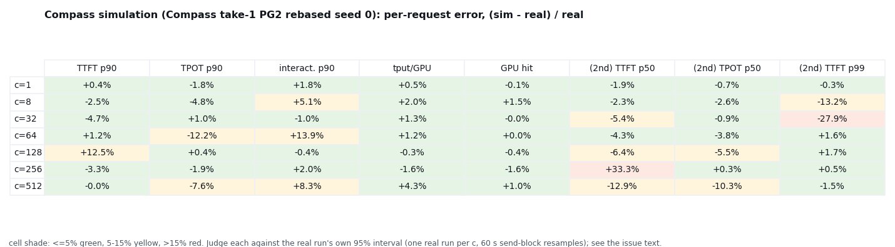

# Compass 仿真与实测对比

Compass 是 ATOM 推理引擎的虚拟时钟仿真器。这里放各 Cell 实测与仿真的 Prometheus 对比图，任务跟踪见 [#791](https://github.com/wuhuikx/LLM-Booster/issues/791)（按 Cell 的总计划与进度，父 issue [#592](https://github.com/wuhuikx/LLM-Booster/issues/592)）。

## 页面一览

- **统一看板（所有配置，可切换）：<https://wuhuikx.github.io/LLM-Booster/compass/dashboard.html>**，见下一节。
- 详细页（每个配置单独一页，含旧定律的对照曲线）：[DSv4.1 Cell A v1](https://wuhuikx.github.io/LLM-Booster/compass/cellA_dashboard.html) · [DSv4.1 Cell A v2 DPA4](https://wuhuikx.github.io/LLM-Booster/compass/cellA_v2_dpa4_dashboard.html) · [DSv4.1 Cell A v2 DEPA2](https://wuhuikx.github.io/LLM-Booster/compass/cellA_v2_depa2_dashboard.html) · [DSv4.1 Cell B 1P1D / 2P1D](https://wuhuikx.github.io/LLM-Booster/compass/cellB_dashboard.html) · [M3.1 Cell A](https://wuhuikx.github.io/LLM-Booster/compass/m31_cellA_dashboard.html)
- 旧的多配置页（样本内定律）：[dashboard_v0_insample.html](https://wuhuikx.github.io/LLM-Booster/compass/dashboard_v0_insample.html)，见「旧多配置看板」一节。

## 统一看板（所有配置，按模型 / 部署方式 / 配置 / 并发切换）

**交互式对比图：<https://wuhuikx.github.io/LLM-Booster/compass/dashboard.html>**

直接打开即可，不需要登录。

- **页面结构：** 顶部依次选模型、部署方式（PD 分离 / aggregated 即单机 PD 混合）、配置、并发。最上面的总览给出所有配置 × 并发的误差热力图；下面是选中配置的误差矩阵、逐请求表和面板曲线（实线实测，虚线仿真）。误差 = 仿真 / 实测 − 1。地址栏 `#` 后面记录当前的选择，复制链接即可直接打开同一个配置和并发。
- **收录的配置：** 每个配置只放最终定律的仿真；旧定律的对照曲线在各自的详细页里。

  | 模型 | Cell · 配置（直达链接） | 定律与仿真 | 并发 | 详细页 |
  |---|---|---|---|---|
  | DeepSeek-V4.1-Flash | [Cell A v1 · TP4 DPA4 EP4，bf16 KV](https://wuhuikx.github.io/LLM-Booster/compass/dashboard.html#model=DeepSeek-V4.1-Flash&dep=aggregated&par=Cell+A+v1+%C2%B7+TP4+DPA4+EP4%EF%BC%8Cbf16+KV+%C2%B7+law+hkb&c=128) | `hkb`，3 个 seed | 1 / 8 / 32 / 64 / 128 / 256 / 512 | [详细页](https://wuhuikx.github.io/LLM-Booster/compass/cellA_dashboard.html) |
  | DeepSeek-V4.1-Flash | [Cell A v2 · D 配置：TP4 DPA4，MoE TP4](https://wuhuikx.github.io/LLM-Booster/compass/dashboard.html#model=DeepSeek-V4.1-Flash&dep=aggregated&par=Cell+A+v2+%C2%B7+D+%E9%85%8D%E7%BD%AE%EF%BC%9ATP4+DPA4%EF%BC%8CMoE+TP4+%C2%B7+law+hcT6PF_hkbc&c=128) | `hcT6PF_hkbc`，3 个 seed；只用有效实测，c=512 对 real2，c=8 / 64 待重录 | 1 / 32 / 128 / 256 / 512 | [详细页](https://wuhuikx.github.io/LLM-Booster/compass/cellA_v2_dpa4_dashboard.html) |
  | DeepSeek-V4.1-Flash | [Cell A v2 · D 配置：TP4 DPA4，MoE TP4（c512 对 real3）](https://wuhuikx.github.io/LLM-Booster/compass/dashboard.html#model=DeepSeek-V4.1-Flash&dep=aggregated&par=Cell+A+v2+%C2%B7+D+%E9%85%8D%E7%BD%AE%EF%BC%9ATP4+DPA4%EF%BC%8CMoE+TP4%EF%BC%88c512+%E5%AF%B9+real3%EF%BC%89%C2%B7+law+hcT6PF_hkbc&c=512) | `hcT6PF_hkbc`，3 个 seed；c=512 对 real3 | 512 | [详细页](https://wuhuikx.github.io/LLM-Booster/compass/cellA_v2_dpa4_dashboard.html) |
  | DeepSeek-V4.1-Flash | [Cell A v2 · P 配置：TP2 DPA2 EP2 MoRI](https://wuhuikx.github.io/LLM-Booster/compass/dashboard.html#model=DeepSeek-V4.1-Flash&dep=aggregated&par=Cell+A+v2+%C2%B7+P+%E9%85%8D%E7%BD%AE%EF%BC%9ATP2+DPA2+EP2+MoRI+%C2%B7+law+de2PbPMf1_hkb&c=128) | `de2PbPMf1_hkb`，3 个 seed（c=1 为 1 个，c=256 / 512 为 6 个） | 1 / 8 / 32 / 64 / 128 / 256 / 512 | [详细页](https://wuhuikx.github.io/LLM-Booster/compass/cellA_v2_depa2_dashboard.html) |
  | DeepSeek-V4.1-Flash | [Cell B · 1P1D（P TP2 DPA2 EP2，D TP4 DPA4）](https://wuhuikx.github.io/LLM-Booster/compass/dashboard.html#model=DeepSeek-V4.1-Flash&dep=pd&par=Cell+B+%C2%B7+1P1D%EF%BC%88P+TP2+DPA2+EP2%EF%BC%8CD+TP4+DPA4%EF%BC%89%C2%B7+law+v2gA_h0&c=240) | `v2gA_h0`，标准顺序 + seed 1 | 16 / 64 / 240 / 256 / 307 | [详细页](https://wuhuikx.github.io/LLM-Booster/compass/cellB_dashboard.html) |
  | DeepSeek-V4.1-Flash | [Cell B · 2P1D（2 × P TP2 DPA2 EP2，D TP4 DPA4）](https://wuhuikx.github.io/LLM-Booster/compass/dashboard.html#model=DeepSeek-V4.1-Flash&dep=pd&par=Cell+B+%C2%B7+2P1D%EF%BC%882+%C3%97+P+TP2+DPA2+EP2%EF%BC%8CD+TP4+DPA4%EF%BC%89%C2%B7+law+v2gA_h0&c=128) | `v2gA_h0`，标准顺序 + seed 1 | 128 | [详细页](https://wuhuikx.github.io/LLM-Booster/compass/cellB_dashboard.html) |
  | MiniMax-M3.1-Flash | [Cell A · TP4 NVFP4 AK-MoE（06d AgentX 的 D 配置）](https://wuhuikx.github.io/LLM-Booster/compass/dashboard.html#model=MiniMax-M3.1-Flash&dep=aggregated&par=Cell+A+%C2%B7+TP4+NVFP4+AK-MoE%EF%BC%8806d+AgentX+%E7%9A%84+D+%E9%85%8D%E7%BD%AE%EF%BC%89%C2%B7+law+v2MFS_hkbx&c=128) | `v2MFS_hkbx`，3 个 seed | 8 / 32 / 64 / 128 | [详细页](https://wuhuikx.github.io/LLM-Booster/compass/m31_cellA_dashboard.html) |

- **没有收录：**
  - Cell C（4P4D C1228）：旧结果的仿真用的是这次实测自己拟合的定律（样本内）。Cell C 只用来检验多 P 多 D 的精度，真实数据不参与拟合，所以没有放进来；旧页面保留在下一节。
  - MiniMax-M3.1-Flash 的 Cell B（单机 1P1D）和 Cell C（两机 1P2D）还没有目标点；Kimi-K3.1、GLM-5.3-Flash、qwen3.8 flash 也还没有。进度见 [#791](https://github.com/wuhuikx/LLM-Booster/issues/791)。
- **生成方式：** g08 上建一个只放符号链接的扫描目录 `/var/tmp/perzhang_compass/dash_unified/`（布局同下），再用 jgong5/ATOM `752/dev` 的 `scripts/compass/compare_dashboard.py --scan` 生成本页；脚本为 g08 上的 `~perzhang/pz_snap/i791_task_1126/unified_dash.sh`，在 `perzhang_cellb2_cpu` 容器里运行（需要 Python 3.11+，且要同时挂载 Cell A 和 Cell B 的数据目录）。新配置按目录约定放进扫描目录、重跑脚本，就会出现在页面上：

  ```
  ROOT/<模型>/<pd|aggregated>/<配置>/c<并发>/
      real/  prom/report-data.json  sims/<label>/prometheus.json  [one_real.txt]  [cell.json]
  ```

## 旧多配置看板（样本内定律，11-25 之前）

**交互式对比图：<https://wuhuikx.github.io/LLM-Booster/compass/dashboard_v0_insample.html>**

直接打开即可，不需要登录。

- **页面结构：** 顶部依次选模型（下拉）、部署方式（PD 分离 / aggregated）、并行配置（下拉）、并发。最上面的总览给出所有配置 × 并发的误差热力图，选一个指标（逐请求的 TTFT / TPOT / 吞吐，或任一 Prometheus 面板）即可横向比较；下面是选中配置的误差矩阵、逐请求表和面板曲线（实线实测，虚线仿真）。误差 = 仿真 / 实测 − 1。
- **当前数据：** 两个并行配置，都是 DeepSeek-V4.1-Flash PD 分离、Mooncake Store 开。每档只展示一条仿真，记作 sim：标准发送顺序（不设发送顺序种子）的那次运行；仿真都用该档自身记录拟合的定律（in-sample）。

  **1P1D（P TP2 EP2，D TP4）**：pit2-p03-g27，c = 1 / 8 / 32 / 64 / 128，每档 1800 s agentic 实跑。

  | 指标（sim） | c=1 | c=8 | c=32 | c=64 | c=128 |
  |---|--:|--:|--:|--:|--:|
  | TTFT P50 | −7.0% | −1.7% | −2.8% | −3.7% | −6.2% |
  | TPOT P50 | 0.0% | −0.5% | −0.7% | −1.0% | −1.1% |
  | 吞吐/卡 | +0.6% | +0.1% | +0.6% | 0.0% | +0.5% |

  **4P4D，即 8P16D（P TP2 DPA2 EP2，D TP4 DPA4 NoEP）**：按 ROCm/ATOM recipe `5effb67d` 的 C1228 配置（P、D 各 4 个实例，D 的 MoE 不开 EP），代码为该 recipe 合入 `dsv41/dev`。P 在 pit2-p03-g48，D 在 g53 和 g52；不经 ingress；Mooncake Store 挂满 1574 GiB，压测前清空。c = 1228，900 s agentic 实跑，所以这一格按 0–900 s 计分（`cell.json` 的 `window_s`）。

  | 指标（sim） | TTFT P50 | TTFT P90 | TPOT P50 | TPOT P90 | E2E P50 | 吞吐/卡 |
  |---|--:|--:|--:|--:|--:|--:|
  | c=1228 | −10.2% | +1.7% | −6.1% | −2.9% | −4.6% | +2.4% |

  这一格偏差最大的面板是 D 接收 KV 的等待（P90 −72%）、Decode TTFT P90（−38%）和 D 排队时间 P90（−33%）：P→D 的 KV 传输尾延迟被低估。分析和用 1P1D 定律外推的对照见 [#745](https://github.com/wuhuikx/LLM-Booster/issues/745#issuecomment-7140337948)。

  PD 部署的仿真报告不含 mesh 入口的 Overall TTFT 面板，所以总览里该面板指标为空；端到端 TTFT 请看逐请求的 TTFT 指标。
- **生成方式：** jgong5/ATOM `scripts/compass/compare_dashboard.py` 的多配置版本，见 [jgong5/ATOM#3939](https://github.com/jgong5/ATOM/pull/3939)（尚未合入；合入前请用该 PR 的分支 `compass/dashboard-multi-config` 生成，`dsv41/dev` 上的旧版不支持 `--scan` 和多配置）。新结果按目录约定放好即可自动出现在页面上，不用手写清单：

  ```
  ROOT/<模型>/<pd|aggregated>/<并行配置>/c<并发>/
      real/  prom/report-data.json  sims/<label>/prometheus.json  [one_real.txt]  [cell.json]
  ```

  `python3 scripts/compass/compare_dashboard.py --scan ROOT --out dashboard.html`（这一页 11-26 起改名为 `dashboard_v0_insample.html`，`dashboard.html` 现在是上面的统一看板）。每个 cell 只放一个仿真目录 `sims/sim/`（标准发送顺序）。计分时长和页面窗口（默认 1800 s）不同的 cell，在 `cell.json` 里写 `window_s`。

  该页面由 `python3 scripts/compass/compare_dashboard.py /share_nfs/xingjche/compass_dashboard/1p1d_sweep_sim/manifest.json --scan /share_nfs/xingjche/x8p16d/dash_pub --title 'Compass · DeepSeek-V4.1-Flash 真实 vs 仿真' --out dashboard.html` 生成（jgong5/ATOM#3939 的分支，`27eade350`）。

## Cell A v1：单机 DPA4-EP4（DeepSeek-V4.1-Flash）

**交互式对比图：<https://wuhuikx.github.io/LLM-Booster/compass/cellA_dashboard.html>**

直接打开即可，不需要登录。

- **对象：** DeepSeek-V4.1-Flash，MI355X 单机 4 卡，DPA4-EP4（4 个 DP attention rank + 专家并行），MTP 投机解码（5 个 draft，强制接受长度 3.51），bf16 KV，decode CUDA graph 档位 1–64，max-num-seqs 64。
- **实测：** 每个并发（c = 1 / 8 / 32 / 64 / 128 / 256 / 512）一次预热后的 30 min agentic 多轮真跑，aiperf 窗口相同。c=512 超过容量（64 条 × 4 rank），以吞吐和 P90 为主看。
- **仿真：** Compass 用同一负载、同一请求序列（发送顺序 seed 0）。实线是实测，虚线是仿真，横轴是从第一个正式请求开始的分钟数，取 1800 s 计分窗口。仿真代码为上游 jgong5/ATOM `dsv41/dev` 2fdaae22（含 #3742 突发接收顺序修复）加本地校准提交，digest 与实测一致。
- **定律，即当前最优方案：理论构造的校准负载 + PG2 定律。**
  - 在真机上录一份校准记录，共 11 段客户端，32 GPU min；只用这份记录拟合，拟合 0.8 min。
  - decode 为 F1：高档位按全组真实 MoE token 计价。
  - prefill 为 PG2：增加 token graph 分桶的 `gather_rows` 列。
  - host law 用平稳段和 decode drain 窗口拟合。
  - 校准方法详解：[#739](https://github.com/wuhuikx/LLM-Booster/issues/739)；优化全过程：[#666 评论](https://github.com/wuhuikx/LLM-Booster/issues/666#issuecomment-7093204062)。

主要看 P90、吞吐和前缀命中率；P50、P99 是次要指标，在汇总表里排在后面并淡化显示。误差 = 仿真 / 实测 − 1（发送顺序 seed 0）。

| 指标 | c=1 | c=8 | c=32 | c=64 | c=128 | c=256 | c=512 |
|---|--:|--:|--:|--:|--:|--:|--:|
| TTFT P90 | +0.4% | −2.5% | −4.7% | +1.2% | +12.5% | −3.3% | −0.0% |
| TPOT P90 | −1.8% | −4.8% | +1.0% | −12.2% | +0.4% | −1.9% | −7.6% |
| 交互度 P90 | +1.8% | +5.1% | −1.0% | +13.9% | −0.4% | +2.0% | +8.3% |
| 吞吐/卡 | +0.5% | +2.0% | +1.3% | +1.2% | −0.3% | −1.6% | +4.3% |
| GPU 前缀命中率 | −0.1% | +1.5% | −0.0% | +0.0% | −0.4% | −1.6% | +1.0% |

- 三种发送顺序取平均后，各项尾部指标都在实测自身的 95% 区间内；唯一系统性的偏差是 c=64 的 TPOT P90（三种顺序平均 −9.6% ± 2.8%），原因是多 rank 同时 decode 时每步定价略低，下一次校准会补上这类负载。
- c=128 的 TTFT P90 受突发时请求落到哪个 rank 的随机性影响大：同一并发的两次实测之间就差 23%。

### 各指标误差一览

前五列是主要指标，带 (2nd) 的是次要指标。



### 各并发的时间曲线（静态截图，交互版见上面的链接）

| c | 图 |
|---|---|
| 1 | [dsv41_cellA_c1.png](png/dsv41_cellA_c1.png) |
| 8 | [dsv41_cellA_c8.png](png/dsv41_cellA_c8.png) |
| 32 | [dsv41_cellA_c32.png](png/dsv41_cellA_c32.png) |
| 64 | [dsv41_cellA_c64.png](png/dsv41_cellA_c64.png) |
| 128 | [dsv41_cellA_c128.png](png/dsv41_cellA_c128.png) |
| 256 | [dsv41_cellA_c256.png](png/dsv41_cellA_c256.png) |
| 512 | [dsv41_cellA_c512.png](png/dsv41_cellA_c512.png) |

### 数据来源

- 实测记录 `real_pw_c*` 与 Prometheus 报告 `prom_real_pw_c*`，校准记录 `cal_theory1`，定律 `store_cal_theory1_pg2`，都在 MI355X 节点 005 的 `~xingjche/perzhang/data/dsv41-mi355/` 下。
- 对比图由 `build_dash.py` 生成：实测与仿真都取同一 Prometheus 导出器的面板，按第一个正式请求对齐时间。

## Cell A v2：单机 DPA4 + MoE TP4（DeepSeek-V4.1-Flash，对应 Cell B 的 D）

**交互式对比图：<https://wuhuikx.github.io/LLM-Booster/compass/cellA_v2_dpa4_dashboard.html>**

直接打开即可，不需要登录。

- **对象：** DeepSeek-V4.1-Flash，MI355X 单机 4 卡，一个聚合实例（prefill 与 decode 在同一实例）：TP4 + DPA4，MoE 走 TP4、不开 EP；fp8 KV，block 16；MTP 5 个 draft（接受长度强制为 3.51）；max-num-seqs 64。配置取自 ROCm/ATOM recipe `DeepSeek-V4.1-6P16D-C1228-Share-Cache.md`（main `5effb67d4`）的 D 实例。
- **实测（只用有效记录）：** pit2 上每个并发 1800 s agentic 真跑。按 owner 的规则，被卡顿影响的实测判为无效，不参与比较：c=1 / 32 / 128 / 256 用 real1；c=512 的 real1 有 30 次 KFD 换出卡顿，改用 real2 和 real3（页面里分成两组，「c512 对 real3」单列）；c=8、c=64 的 real1 无效，重录已排队，暂不显示。
- **仿真：** 最终定律 `hcT6PF_hkbc`（owner 11-26 约 15:00 UTC 决定，按 [#739](https://github.com/wuhuikx/LLM-Booster/issues/739) 只用校准数据做留一段交叉验证选出）：在 `hcT_hkbc` 的基础上加 PM 规则（拟合 `COMPASS_FIT_PREFILL_PHASE_MAX=1`，仿真 `COMPASS_PREFILL_PHASE_MAX=1`），用原校准、三段补充校准和 addPM、addHit 两段补充校准合并拟合。发送顺序 seed 0–2；本页另画上一版 `hcT_hkbc` 作对照（统一看板里只放 `hcT6PF_hkbc`）。
- **误差（仿真 / 实测 − 1，三个 seed 的平均；c=512 对 real2、real3 的平均）：**

  | 指标 | c=1 | c=32 | c=128 | c=256 | c=512 |
  |---|--:|--:|--:|--:|--:|
  | TTFT P90 | −1.6% | +0.4% | +6.1% | +3.9% | −4.0% |
  | TPOT P90 | −1.1% | −7.0% | −3.8% | −8.0% | −5.7% |
  | 每卡吞吐 | +0.8% | +0.9% | +0.7% | +2.1% | +2.8% |

  未关：c=128 的 TTFT P90（+6.1%，3 个 seed）正在补到 6 个 seed；c=32 / 256 / 512 的 TPOT P90 偏低在查。c=8、c=64 重录后补入。逐点数字见 [#766](https://github.com/wuhuikx/LLM-Booster/issues/766)。

## Cell A v2：单机 DEPA2（DeepSeek-V4.1-Flash，对应 Cell B 的 P）

**交互式对比图：<https://wuhuikx.github.io/LLM-Booster/compass/cellA_v2_depa2_dashboard.html>**

直接打开即可，不需要登录。

- **对象：** DeepSeek-V4.1-Flash，MI355X 单机 2 卡，一个聚合实例：TP2 + DPA2 + EP2（MoRI）；fp8 KV；MTP 5 个 draft（接受长度强制为 3.51）。配置取自同一 recipe 的 P 实例。
- **实测：** c = 1 / 8 / 32 / 64 / 128 / 256 / 512 各一次 1800 s agentic 真跑；c=512 的预热占 3.3 h。
- **仿真：** 最终定律 `de2PbPMf1_hkb`：prefill 向量在 PM 规则下重新拟合（`COMPASS_FIT_PREFILL_PHASE_MAX=1`），仿真时打开 `COMPASS_PREFILL_PHASE_MAX=1`（jgong5/ATOM `752/dev` 8e9b2fc2a）。上一版 `de2Pb_hkb` 一起画出作对照。发送顺序 seed 0–2，c=256、c=512 为 seed 0–5。
- **误差（c=1…256 的平均绝对误差）：** TTFT P90 4.6%，TPOT P90 4.5%，每卡吞吐 1.2%。未关：c=512 的 TTFT P90 约 −35%（空闲上限同时释放的一批长请求，仿真里排队偏短）。详见 [#766](https://github.com/wuhuikx/LLM-Booster/issues/766)。

## MiniMax-M3.1-Flash Cell A：单机 PD 混合（c=8…128）

**交互式对比图：<https://wuhuikx.github.io/LLM-Booster/compass/m31_cellA_dashboard.html>**

直接打开即可，不需要登录。

- **对象：** MiniMax-M3.1-Flash，MI355X 单机 4 卡，一个聚合实例，用 06d AgentX recipe 的 D 配置（ROCm/ATOM `Jasen/m31-agentx-repro` e1561f3d5，`recipes/m31_agentx_1p2d`）：TP4，C17 decode kernel，AK MoE，lm_head AK + ring，NVFP4 KV 与 index cache，DSpark k=7（接受长度强制为 4.04）。唯一偏离：单机聚合时 D 配置也要做 16k prefill，AK MoE 的 prefill 路径会让 GPU 空转，所以 AK MoE 只用于 ≤2048 行（`ATOM_M3_AK_MOE_MAX=2048`），decode 与 recipe 相同。
- **实测：** c = 8 / 32 / 64 / 128，各一次 1800 s agentic 真跑；c=1、c=256、c=512 按 owner 要求暂缓。
- **仿真：** 定律 `v2MFS_hkbx`，在 host 标签修复（jgong5/ATOM `752/dev` 29f78cfc8）后重新拟合；修复前的 `v2MFS_hkb` 不再使用。发送顺序 seed 0–2。**定律对 c=8…128 定稿**；c=1、c=256、c=512 录完后补入本页。
- **误差（三个 seed 的平均）：**

  | 指标 | c=8 | c=32 | c=64 | c=128 |
  |---|--:|--:|--:|--:|
  | TTFT P90 | −0.2% | +0.5% | +2.5% | +0.4% |
  | TPOT P90 | +0.5% | −1.0% | +3.4% | −13.0% |
  | 每卡吞吐 | +0.4% | +0.2% | 0.0% | −1.0% |

  c=64 的 TTFT P50 为 +39.5%：KV 反复换出使 TTFT 分布出现空档，中位数落在空档里，按区间配对比较在 ±4.4% 以内。c=128 的 TPOT P90 偏低 13%，原因还在查。详见 [#767](https://github.com/wuhuikx/LLM-Booster/issues/767)。

## Cell B v2：1P1D 分离（DeepSeek-V4.1-Flash，compass 主分支重做）

**交互式对比图：<https://wuhuikx.github.io/LLM-Booster/compass/cellB_dashboard.html>**

直接打开即可，不需要登录。

- **对象：** DeepSeek-V4.1-Flash，MI355X 单机 1P1D。P 为 TP2（DPA2 + EP2，MoRI），D 为 TP4（DPA4，不开 EP）；fp8 KV，MTP 5 个 draft（接受长度强制为 3.51），开 Mooncake Store。2P1D 为两个同样的 P 加一个 D。
- **实测：** compass 主分支（jgong5/ATOM `752/dev`，digest `7d7bd41e`）上录制。c307、c256 用于拟合，r240（c=240）、w1（c=64、c=16）、2P1D c=128 是样本外点；aiperf 窗口 900 s（w1 为 600 s）。
- **仿真：** 最终定律 v2g A+h0（`752/dev` f2d202a4e，`COMPASS_FIT_MOE_FOLDS=covered`，按 #739 只用校准数据选律）。每个点有标准发送顺序和种子 1 两次仿真；旧律 v2f A+h0 也在页面中作对照。
- **误差（仿真 / 实测 − 1，两次平均；6 个点的平均绝对误差）：** TTFT P50 1.6%，TTFT P90 5.3%，TPOT P90 1.7%，每卡吞吐 0.7%。逐点数字和运行时间对比见 [#734](https://github.com/wuhuikx/LLM-Booster/issues/734)。
- **已知空面板：** 实测的 GPU per-step 面板为空（录制时未开设备计时）；仿真的 Overall TTFT 为空；Store 只体现在 Prefill cache hit 里的 Store hit 曲线中。
